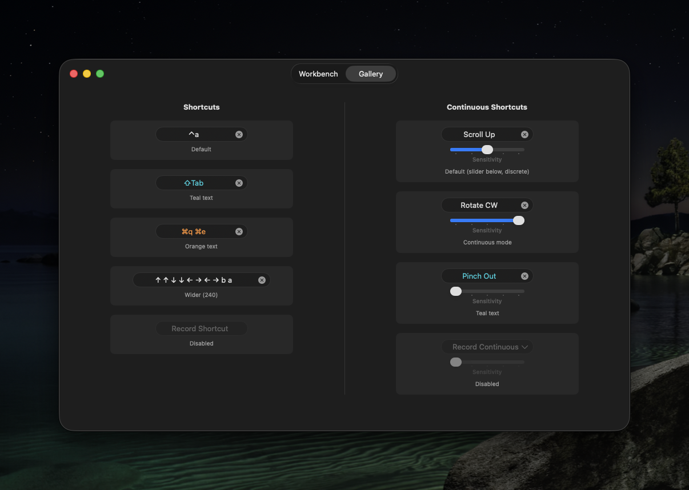

# ShortcutField

[](https://swift.org)
[](https://developer.apple.com/macos/)
[](LICENSE)

A unified in-app shortcut recorder for macOS apps.

`Shortcut` is the umbrella type, an enum with two cases:

- **`.discrete(DiscreteShortcut)`**: fire-once shortcuts. One step (e.g. `⌘K`, `Right Click`, `Pinch In`) or a multi-step sequence (e.g. `⌘K ⌘C`, `A → Right Click`). The matcher fires the bound action exactly once when the user completes the full sequence.
- **`.continuous(ContinuousShortcut)`**: sensitivity-bearing throttled continuous fire. A single scroll / pinch / rotate gesture with a user-tunable `sensitivity` controlling the throttle rate (e.g. scroll-to-zoom).

Special keys like Tab that SwiftUI's focus system normally intercepts can be recorded and matched.



### Features

- Record any in-app input: key, mouse button, scroll direction, trackpad gesture (pinch / rotate / smart magnify)
- Multi-step shortcuts (e.g. `⌘K ⌘C`, `A → Right Click`, `⌘K → Pinch In`)
- Sensitivity-throttled continuous gestures via `ContinuousShortcut`
- One `.onShortcut()` modifier for both kinds, plus a public `ShortcutMatcher` for manual matching
- VS Code-style text syntax: `Shortcut("cmd+k cmd+c")`, `try Shortcut(ascii:)`, round-trippable `.ascii`
- Match against `NSEvent` and SwiftUI `KeyPress`, including special keys like Tab and Escape
- SwiftUI views and AppKit controls
- `Codable`, `Equatable`, `Hashable`, `Sendable` model

## Requirements

- macOS 13+
- Swift 6.2+

## Installation

Add ShortcutField to your project via Swift Package Manager:

```swift
dependencies: [
    .package(url: "https://github.com/nielsmadan/ShortcutField", from: "2.4.0")
]
```

## Usage

See the [Example app](Example/) for a workbench and gallery of all recorder styles.

### Recording fire-once shortcuts (SwiftUI)

```swift
import ShortcutField

struct SettingsView: View {
    @State private var shortcut: DiscreteShortcut?

    var body: some View {
        ShortcutRecorderView($shortcut)
            .placeholder("Record Shortcut")
    }
}
```

The recorder accepts whatever the user performs: a single keystroke, a (modified) mouse click, a scroll, a trackpad gesture, or a multi-step sequence. Recording finalizes after a 1-second idle pause OR on a bare left-click anywhere in the field's window (no modifiers), the unambiguous "I'm done" gesture.

### Recording continuous (sensitivity-bearing) shortcuts

```swift
import ShortcutField

struct ZoomSettingsView: View {
    @State private var zoomShortcut: ContinuousShortcut?

    var body: some View {
        ContinuousShortcutRecorderView($zoomShortcut)
            .placeholder("Record Zoom")
    }
}
```

A chevron menu next to the field provides a click-only path for picking continuous kinds (scroll / pinch / rotate) without performing them.

### Recording shortcuts (AppKit)

```swift
import ShortcutField

let field = ShortcutRecorderField()
field.onShortcutChange = { shortcut in            // shortcut is DiscreteShortcut?
    print("Recorded: \(shortcut?.displayString ?? "none")")
}

let continuousField = ContinuousShortcutRecorderField()
continuousField.onShortcutChange = { shortcut in  // shortcut is ContinuousShortcut?
    print("Recorded: \(shortcut?.displayString ?? "none")")
}
```

### Matching shortcuts

`.onShortcut()` takes the umbrella `Shortcut?` and fires an action when it's performed: once on completion for `.discrete`, repeatedly (throttled) for `.continuous`:

```swift
// A recorder binds a DiscreteShortcut?; lift it into the umbrella to match it.
MyView()
    .onShortcut(recordedShortcut.map(Shortcut.discrete)) {
        print("Shortcut fired!")
    }

// A static shortcut can be a string literal (see Text syntax below).
MyView()
    .onShortcut("cmd+k cmd+c") {
        print("Chord fired!")
    }

// Continuous shortcuts fire repeatedly during the gesture, throttled by sensitivity.
MyView()
    .onShortcut(zoomShortcut.map(Shortcut.continuous)) {
        zoomLevel += 0.05
    }
```

For 1-step discrete shortcuts the action fires once on the matching event. For multi-step shortcuts the action fires once when the full sequence completes within the per-step timeout (1 second). For continuous shortcuts it fires on each throttled gesture event.

Every mounted `.onShortcut` fires on a matching event in any window of the app. In an app with several windows, pass `scope: .window` so a binding fires only for events sent to the window containing its view. A binding declared inside a sheet, panel or popover acts on that window; events sent to any other window pass through:

```swift
DocumentView()
    .onShortcut("cmd+shift+e", scope: .window) {
        export(document)
    }
```

### Typing takes precedence

While a text-editing responder has focus, shortcuts the user could plausibly have *typed* stay out of the way. The rule is derived from the shortcut's shape — there is nothing to configure:

| Shortcut shape | While a text field has focus |
|---|---|
| Carries ⌘ or ⌃ | Fires. `⌘S` must save wherever focus sits. |
| Escape, or F1–F20 | Fires. These keys produce no text, so typing can't reach them. |
| Bare key, or ⇧/⌥-only | Suppressed; the keystroke goes to the field. |
| Mouse, scroll, or gesture | Fires. Not keyboard input. |

So a `K` bound to "open search" no longer eats the `k` in "keyboard", while a bare `F5` still fires wherever the caret is.

Navigation and editing keys — arrows, Home/End, Page Up/Down, Tab, Return, Space, Delete — stay suppressed: each one acts on the text, so the field must keep receiving them.

Multi-step shortcuts are gated on their **first** step only. Once the user has pressed the `⌘K` of `⌘K S`, they have committed to the sequence, so the bare `S` completes it even with the caret in a text field.

"Text-editing" means the first responder is an editable `NSTextView`. Because AppKit installs a text field's *field editor* as first responder, that covers `NSTextField`, `NSSearchField`, `TextEditor`, and SwiftUI's `TextField`. Buttons and other non-text responders don't suppress anything. A `WKWebView` holding a focused `contenteditable` node is **not** detected — that needs an asynchronous JavaScript round trip, and the gate runs synchronously inside the event monitor.

For manual matching, drive a `ShortcutMatcher` yourself or use the `matches()` primitives directly:

```swift
// ShortcutMatcher: feed it NSEvents from a local monitor and inspect the ShortcutMatchResult.
// Returning nil consumes the event, so it doesn't also reach the focused view.
let matcher = ShortcutMatcher(.discrete(shortcut))
NSEvent.addLocalMonitorForEvents(matching: [.keyDown, .scrollWheel, .magnify]) { event in
    switch matcher.handle(event) {
    case .fired:                       runAction(); return nil
    case .continuousFired(let delta):  runAction(scaledBy: delta); return nil
    case .advanced(let consume):       return consume ? nil : event
    case .ignored:                     return event
    }
}

// Or match a single Step / ContinuousShortcut against an NSEvent directly.
discreteShortcut.steps[0].matches(event)
discreteShortcut.steps[0].matches(press)   // SwiftUI KeyPress, .key kinds only
continuousShortcut.matches(event)
```

`matches(press)` never fires on a key-up press. Special keys (Tab, arrows, F1–F20, Forward Delete, Help, keypad Enter and Clear) match by `press.key`. Other keys compare `press.characters` with the character the current keyboard layout produces, so a step holding Shift (`⇧1`) matches either `1` or `!`.

### Keyboard ownership for modal input

A palette or modal editor can pause ordinary shortcuts in its window while AppKit
continues handling typing, editing commands, dead keys, and IME input:

```swift
// Store this token on the presentation/session, before focusing its search field.
let ownership = ShortcutEventDispatcher.shared.acquireKeyboardOwnership(for: window)

// When the presentation ends, including when a reusable panel is hidden:
ownership.release()
```

Ownership suppresses all dispatcher shortcut kinds in that concrete window,
including `.onShortcut` bindings with app scope. Other windows keep receiving
shortcuts. Sheets and child panels need tokens for their own concrete windows.
Tokens compose: releasing one leaves other owners effective; repeated
release is harmless. Tokens do not retain windows. Dropping a token also releases
it, synchronously on the main thread or via the main actor when dropped elsewhere.

The first owner and last release for a live window synchronously interrupt all registered consumers.
Releasing tokens after their window deallocates leaves other consumers undisturbed.
This deliberately clears pending state app-wide because dispatcher registrations
have no window identity. Moving the event stream between windows (including a
windowless event) also interrupts consumers. A sequence cannot begin in one window
and complete in another. `.onShortcut` interrupts its matcher automatically. Pending sequences and throttling are
cancelled, while an already-claimed gesture keeps its suppression until its end or
a fresh burst. This prevents one physical gesture from firing again after a brief
ownership transition. Claimed scroll momentum remains consumed after ownership ends.

Custom consumers use the interruption overload to interrupt their own matchers and
cancel buffered work. If a delivery batch is already being flushed, invalidate its
remaining entries too; clearing only the pending queue does not cancel a copied batch.
An interruption is a cancellation signal, not a synthesized gesture-end event.

```swift
let matcher = ShortcutMatcher("cmd+k cmd+c")
let listenerID = UUID()
ShortcutEventDispatcher.shared.register(
    id: listenerID,
    onInterruption: { matcher.interrupt() },
    handler: { event in matcher.handle(event) }
)
// At consumer teardown:
ShortcutEventDispatcher.shared.unregister(id: listenerID)
```

Acquiring ownership inside a shortcut callback stops later handlers from seeing
that opening event, even when the callback immediately releases ownership or opens
a different window. An event already consumed stays consumed. Interruption callbacks
may change ownership or registrations; nested interruptions are coalesced, and
removed/replaced registrations are skipped in an in-flight delivery.

Recorder capture remains independent: a recorder still receives input in an owned
window, and its existing app-wide matching suppression lasts until recording ends.
Ownership does not affect independently installed monitors, manually fed matchers,
or Carbon global hotkeys. There is no automatic dismissal or focus change.

The example app's **Input Ownership** tab provides owner controls, a native text
field, shortcut counters, and a recorder. Add two owners, type and edit, release
one, then release the last; counters should resume only after the last release.
Use **File → New Window** to exercise a second window. Also check native composition,
recorder Tab/Shift-Tab, and Escape cancellation with ownership active.

### Text syntax

`Shortcut` and `DiscreteShortcut` round-trip through a VS Code-style ascii string:

```swift
let chord: Shortcut = "cmd+k cmd+c"                  // ExpressibleByStringLiteral
let zoom = try Shortcut(ascii: "scroll-up @0.5")     // .continuous, sensitivity 0.5
let parsed = try DiscreteShortcut(ascii: "ctrl+right-click")

chord.ascii        // "cmd+k cmd+c"  (round-trips)
```

- **Modifiers**: `cmd`, `ctrl`, `opt`, `shift`, joined with `+`.
- **Keys**: `a`–`z`, `0`–`9`, `tab`, `return`, `escape`, `space`, `delete`, arrows, `home`/`end`/`pageup`/`pagedown`, `f1`–`f12`, punctuation names.
- **Mouse**: `left-click`, `right-click`, `middle-click`, `button4`, `button5`.
- **Scroll / gestures**: `scroll-up/down/left/right`, `pinch-in`, `pinch-out`, `rotate-clockwise`, `rotate-counterclockwise`, `smart-magnify`.
- **Multi-step**: space-separated steps, e.g. `cmd+k cmd+c`.
- **Sensitivity**: a ` @N` suffix (`0.0...1.0`) on a single bare gesture makes it `.continuous`, e.g. `pinch-out @0.5`.

A single bare gesture string resolves to `.continuous`; anything else (multi-step, key, mouse, `smart-magnify`) resolves to `.discrete`. `ExpressibleByStringLiteral` (used for *literals*) traps on a malformed string; the throwing `init(ascii:)` is for runtime input and throws `ShortcutParsingError`.

### Display strings

```swift
let key = DiscreteShortcut(keyCode: UInt16(kVK_Tab), modifiers: [.command, .shift])
print(key.displayString) // "⇧⌘Tab"

let click = DiscreteShortcut(kind: .mouseButton(number: 1), modifiers: .control)
print(click.displayString) // "⌃Right Click"

let sequence = DiscreteShortcut(steps: [
    .init(keyCode: 40, modifiers: .command),  // ⌘K
    .init(keyCode: 8, modifiers: .command),   // ⌘C
])
print(sequence.displayString) // "⌘K ⌘C"

let zoom = ContinuousShortcut(kind: .pinchIn, modifiers: .command, sensitivity: 0.5)
print(zoom.displayString) // "⌘Pinch In"
```

The umbrella `Shortcut` has a `displayString` that forwards to the inner value's.

### Customization

```swift
ShortcutRecorderView($shortcut)
    .textColor(.teal)
    .minimumWidth(180)
```

The same modifiers apply to `ContinuousShortcutRecorderView`.

### Sensitivity (ContinuousShortcut only)

The sensitivity controls how often a `.continuous` `.onShortcut()` fires during a single physical gesture: `0.0` fires once per gesture, `1.0` fires on every matching event, intermediate values map to a per-fire cooldown.

```swift
ContinuousShortcutRecorderView($zoomShortcut)
    .sensitivityMode(.discrete)        // .discrete (5 ticks) or .continuous
    .sensitivityPosition(.below)        // .below, .left, or .right
```

Discrete mode snaps to five tick marks (0, 0.25, 0.5, 0.75, 1.0). Continuous is a free 0.0-1.0 slider.

> **Why no swipe gestures?** macOS only delivers `NSEvent.swipe` events to apps when the user has enabled "Swipe between pages: Swipe with three fingers" in System Settings → Trackpad → More Gestures, and 4-finger swipes have no equivalent setting (they're reserved by macOS for Mission Control / App Exposé / switch-between-full-screen-apps). Reliable cross-app multi-finger gesture detection on macOS requires the private `MultitouchSupport` framework (used by apps like BetterTouchTool), which would prevent App Store distribution and risk notarization. ShortcutField stays within public APIs, so swipes are out of scope.

## API

### `Shortcut`

The umbrella shortcut type, an enum over the two kinds. `Codable`, `Equatable`, `Hashable`, `Sendable`, `ExpressibleByStringLiteral`.

| Case / Member | Description |
|---|---|
| `.discrete(DiscreteShortcut)` | A fire-once shortcut |
| `.continuous(ContinuousShortcut)` | A sensitivity-bearing continuous shortcut |
| `kind: Shortcut.Kind` | `.discrete` or `.continuous` |
| `displayString: String` | Forwards to the inner value's display string |
| `init(ascii:) throws` | Parse a text shortcut; resolves discrete vs continuous (see Text syntax) |
| `ascii: String` | Round-trippable text representation |

### `DiscreteShortcut`

A fire-once shortcut: one or more ordered steps. `Codable`, `Equatable`, `Hashable`, `Sendable`.

| Property/Method | Description |
|---|---|
| `steps: [Step]` | One or more ordered steps (non-empty) |
| `displayString: String` | Steps joined by space, e.g. `⌘K ⌘C` |
| `init(steps:)` | Build from an explicit step list |
| `init(kind:modifiers:)` | Convenience for a 1-step shortcut |
| `init(keyCode:modifiers:)` | Convenience for a 1-step keyboard shortcut |
| `init(ascii:) throws` | Parse a text shortcut (a ` @N` sensitivity suffix throws) |
| `ascii: String` | Round-trippable text representation |

#### `DiscreteShortcut.Step`

A single recordable input within a shortcut.

| Property/Method | Description |
|---|---|
| `kind: DiscreteShortcut.Kind` | `.key(keyCode:)`, `.mouseButton(number:)`, `.scroll(direction:)`, `.pinchIn`, `.pinchOut`, `.rotateClockwise`, `.rotateCounterClockwise`, `.smartMagnify` |
| `modifiers: NSEvent.ModifierFlags` | Modifier flags (Command, Shift, Option, Control) |
| `displayString: String` | Human-readable, e.g. `⌘K`, `⌃Right Click`, `⇧Scroll Up`, `⌘Pinch In` |
| `init(kind:modifiers:)` | Build any kind |
| `init(keyCode:modifiers:)` | Convenience for keyboard steps |
| `matches(_ event: NSEvent) -> Bool` | Match against an NSEvent (any kind) |
| `matches(_ press: KeyPress) -> Bool` | Match against a SwiftUI KeyPress (key kinds only, key-up never matches; macOS 14+) |

### `ContinuousShortcut`

Sensitivity-bearing single-step shortcut for throttled continuous fire. `Codable`, `Equatable`, `Hashable`, `Sendable`.

| Property/Method | Description |
|---|---|
| `kind: ContinuousShortcut.Kind` | Continuous kind only: `.scroll`, `.pinchIn/Out`, `.rotateClockwise/CounterClockwise`. Discrete kinds are unrepresentable at the type level. |
| `modifiers: NSEvent.ModifierFlags` | Modifier flags (Command, Shift, Option, Control) |
| `sensitivity: Double` | 0.0 (fire once per gesture) to 1.0 (every matching event), clamped in init |
| `displayString: String` | Human-readable, same format as a single `DiscreteShortcut.Step` |
| `init(kind:modifiers:sensitivity:)` | Build with sensitivity (default 0.0) |
| `matches(_ event: NSEvent) -> Bool` | Match against an NSEvent |

#### `ContinuousShortcut.Kind`

The continuous-only subset of `DiscreteShortcut.Kind`. Lift to / project from the discrete kind via `asDiscreteKind` and `init(_ discreteKind:)` (the latter returns nil for discrete-only kinds).

```swift
public enum Kind: Sendable, Equatable, Hashable {
    case scroll(direction: DiscreteShortcut.ScrollDirection)
    case pinchIn, pinchOut
    case rotateClockwise, rotateCounterClockwise
}
```

### `ShortcutMatcher`

`@MainActor` matcher for driving event matching yourself. Construct one with any `Shortcut` and feed it `NSEvent`s.

| Member | Description |
|---|---|
| `init(_ shortcut: Shortcut)` | Build a matcher for a discrete or continuous shortcut |
| `handle(_ event: NSEvent) -> ShortcutMatchResult` | Feed one event; see `ShortcutMatchResult` below |
| `reset()` | Discard all sequence, throttle, gesture, and window state |
| `interrupt()` | Cancel pending matching while preserving suppression of already-claimed gesture tails |
| `trackingStateDidChange: ((Bool) -> Void)?` | Notified when a multi-step match starts/stops tracking |

`ShortcutMatchResult` is `.ignored`, `.advanced(consumeEvent:)` (no fire, but consume per the flag: an intermediate step, a held key's repeat, a throttled continuous event, or the rest of a burst that fired), `.fired` (a discrete shortcut completed), or `.continuousFired(magnitude:)` (a throttled continuous fire, with the event's signed delta).

### `ShortcutEventDispatcher`

`@MainActor` app-wide singleton wrapping a single `NSEvent` local monitor with handler fan-out. `.onShortcut()` is built on it; use it directly for custom dispatch.

| Member | Description |
|---|---|
| `ShortcutEventDispatcher.shared` | The shared instance |
| `register(id: UUID, handler:)` | Register a handler (`(NSEvent) -> ShortcutMatchResult`); the monitor installs lazily on the first registration |
| `register(id:onInterruption:handler:)` | Register with synchronous cancellation on ownership and event-window boundaries |
| `acquireKeyboardOwnership(for:)` | Pause dispatcher matching in a window until its ownership tokens release |
| `unregister(id: UUID)` | Remove a handler; the monitor is torn down when the last one is removed |

Handlers are consulted **newest-first**; the event is consumed if any returns `.fired`, `.continuousFired`, or `.advanced(consumeEvent: true)`. Handlers advance in parallel while routing is uninterrupted. Keyboard ownership pauses delivery in the owned window; acquisition during a callback stops later handlers for that event. See [Keyboard ownership](#keyboard-ownership-for-modal-input).

### `ShortcutParsingError`

Thrown by `init(ascii:)`: `.empty`, `.unknownModifier(String)`, `.unknownKey(String)`, `.unknownGesture(String)`, `.malformedSensitivity(String)`, `.sensitivityOnDiscrete`, `.emptyStep`.

### `ShortcutRecorderView`

SwiftUI recorder for fire-once shortcuts. Binds a `DiscreteShortcut?`.

| Modifier | Description |
|---|---|
| `.placeholder(_:)` | Text when empty (default: "Record Shortcut") |
| `.recordingPlaceholder(_:)` | Text during recording (default: "Record shortcut…") |
| `.textColor(_:)` | Text color (SwiftUI `Color`) |
| `.minimumWidth(_:)` | Minimum intrinsic width in points (default 160). SwiftUI's `.frame(width:)` still wins. |

### `ContinuousShortcutRecorderView`

SwiftUI recorder for sensitivity-bearing continuous shortcuts. Binds a `ContinuousShortcut?`.

| Modifier | Description |
|---|---|
| `.placeholder(_:)` | Text when empty (default: "Record Continuous") |
| `.recordingPlaceholder(_:)` | Text during recording (default: "Scroll / pinch / rotate…") |
| `.textColor(_:)` | Text color (SwiftUI `Color`) |
| `.minimumWidth(_:)` | Minimum intrinsic width in points (default 160). SwiftUI's `.frame(width:)` still wins. |
| `.sensitivityMode(_:)` | `.discrete` (default) or `.continuous` |
| `.sensitivityPosition(_:)` | `.below` (default), `.left`, or `.right`; placement of the sensitivity slider |

### AppKit recorder fields

`ShortcutRecorderField` (records `DiscreteShortcut?`) and `ContinuousShortcutRecorderField` (records `ContinuousShortcut?`) are the underlying `NSSearchField` subclasses. Public for direct use.

### `.onShortcut(_:perform:)`

View modifier that fires an action when a `Shortcut` is performed. Takes the umbrella `Shortcut?`.

For `.discrete` shortcuts the action fires once on completion: immediately for 1-step, after the full sequence for multi-step (intermediate events propagate normally; only focus-intercepted keys like Tab/Escape are consumed mid-sequence). For `.continuous` shortcuts it fires on each throttled gesture event. Once a trackpad gesture or scroll fires a discrete shortcut or matches a continuous one, the rest of that gesture and its momentum are consumed too, apart from its end event. Multiple shortcuts that share a common prefix (e.g. `A B` and `A T`) work correctly: each tracks independently and the shared dispatcher delivers events to active matchers while routing is uninterrupted. Matching is automatically disabled while any recorder field is active. Bare-key and ⇧/⌥-only shortcuts are suppressed while a text-editing responder has focus (Escape and F1–F20 are exempt) (see [Typing takes precedence](#typing-takes-precedence)).

### `.onShortcut(_:scope:perform:)` and `ShortcutScope`

The same modifier limited to a `ShortcutScope`. `.app` responds to every window, like `.onShortcut(_:perform:)`. `.window` fires only for events sent to the window containing the view (a sheet, panel or popover is a window of its own); it never fires for events sent to no window or before the view is in a window, and a key press or click in another window ends a multi-step sequence in progress.

### `ShortcutTracking`

`@MainActor` namespace exposing one read-only flag.

| Property | Description |
|---|---|
| `ShortcutTracking.isActive: Bool` | `true` when at least one `ShortcutMatcher` is partway through matching a multi-step shortcut, whether built by `.onShortcut()` or constructed directly. Used to suppress the macOS system alert beep on intermediate keys (see [Suppressing the system alert sound](#suppressing-the-system-alert-sound)). |

### `ShortcutRecording`

`@MainActor` namespace exposing one read-only flag.

| Property | Description |
|---|---|
| `ShortcutRecording.isActive: Bool` | `true` when any recorder field (fire-once or continuous) is currently capturing input. Useful for hosts that want to suppress their own keyboard handling, hotkey libraries, or menu key equivalents while a shortcut is being recorded. |

## Notes

### Recorder behavior

Both `ShortcutRecorderField` and `ContinuousShortcutRecorderField` share these behaviors:

- **Click** or tab into the field to start recording
- **Tab** or **Shift-Tab** in `ContinuousShortcutRecorderField` stops recording, keeps the current shortcut and moves focus on; `ShortcutRecorderField` always records them like any other key, which is a requirement: bare Tab must stay recordable
- **Escape** cancels recording without saving; `ShortcutRecorderField` records Escape with a modifier (e.g. `⇧⎋`) as a step
- **Delete** clears the current shortcut (multi-step recorder: only when no steps have been recorded yet); so does the clear (x) button
- Only one recorder can be active at a time. Focusing a new recorder ends the previous one.
- Recording ends, keeping what was captured, when the field's window stops being key; closing the window, or disabling the field, discards it. Input sent to other windows is never recorded.
- VoiceOver reads the field as "Shortcut" (`setAccessibilityLabel(_:)` replaces it) with the shortcut as text, and announces when recording starts and ends. The continuous recorder's slider reads as "Sensitivity" with a percentage.

`ShortcutRecorderField` finalizes after a 1-second pause between captured steps OR on a bare left-click anywhere in its window (no modifiers). Each captured step resets the idle timer. Tab is recorded like any other key, and a held key records once, not once per auto-repeat. **Bare left-click can't be a step**: it's reserved for UI interaction (focusing controls, dismissing the recorder) and serves as the "finalize" gesture. Modified left clicks (e.g. `⌃Left Click`) are capturable. All other inputs, including right click and other mouse buttons, can be captured anywhere in the field's window with no modifiers required.

`ContinuousShortcutRecorderField` finalizes on the first matching gesture event (after threshold accumulation for pinch / rotate). It only accepts continuous kinds; keys, mouse buttons, and smart-magnify are ignored during recording. A chevron menu provides click-only entry for picking gesture kinds without performing them.

### Suppressing the system alert sound

When using `.onShortcut()` with multi-step shortcuts, intermediate key events propagate through the responder chain. If nothing else handles them, macOS plays the system alert sound.

To suppress the beep only during active sequence input (while still allowing it for random unhandled keys), apply the `suppressShortcutBeep()` modifier to any view in your scene:

```swift
import ShortcutField

WindowGroup {
    ContentView()
        .suppressShortcutBeep()
}
```

This is the recommended path for SwiftUI hosts, which don't own the `WindowGroup` window's class. It installs a one-time `noResponder(for:)` override gated on `ShortcutTracking.isActive`.

When there's no view to hang the modifier off — an AppKit host, or a launch path that runs before any window exists — call the equivalent directly:

```swift
ShortcutTracking.installBeepSuppression()
```

It's idempotent, so it's safe on every launch path. This patches `NSResponder`, which covers the stock `NSWindow`.

If you're an AppKit host that owns its `NSWindow` subclass, override `noResponder(for:)` directly instead — your override would otherwise shadow the one above:

```swift
import ShortcutField

class MainWindow: NSWindow {
    override func noResponder(for eventSelector: Selector) {
        if eventSelector == #selector(keyDown(with:)),
           ShortcutTracking.isActive {
            return // suppress beep only during in-progress multi-step matches
        }
        super.noResponder(for: eventSelector)
    }
}
```

`ShortcutTracking.isActive` is `true` whenever at least one `ShortcutMatcher` has matched one or more intermediate steps and is waiting for the next event, whether the matcher was built by `.onShortcut()` or constructed directly by a host. It resets automatically on completion, timeout, or mismatch.

### System-reserved hotkeys

Shortcuts that collide with a macOS system hotkey, such as `Cmd+Space` (Spotlight), the Mission Control / Spaces keys, or screenshot shortcuts, cannot be recorded or matched. macOS consumes those combos at the system level before they ever reach the app, and ShortcutField only sees events delivered to the app (it uses local `NSEvent` monitors, not a system event tap).

This is different from Tab: Tab *is* delivered to the app, macOS just routes it through the in-app focus system first, so ShortcutField can intercept it. A system-reserved combo never arrives at all.

Symptoms:

- In the recorder, pressing such a combo does nothing: the recorder can't see it, so it captures no step.
- A shortcut recorded *before* the user enabled the conflicting OS shortcut will silently stop firing once the OS claims the combo.

There's no in-app workaround; intercepting system hotkeys requires a system-wide event tap with Accessibility permission, which is out of scope for an in-app shortcut library. If you need global/system-wide hotkeys, see [KeyboardShortcuts](https://github.com/sindresorhus/KeyboardShortcuts).

## Contributing

Issues and pull requests are welcome.

## Releases

Releases use [curtains](https://github.com/nielsmadan/curtaincall); install it first with
`brew install nielsmadan/tap/curtaincall`. Run `just release` from a clean `main` checkout with
complete history. Curtains never fetches: the fetched `origin/main` must be an ancestor of `HEAD`,
and every `vMAJOR.MINOR.PATCH` tag must exist both locally and on origin and point to the same
commit. It proposes a version, runs `just check` and `just build-docs`, then asks for
confirmation. Enter `y` to publish, a version or `patch`/`minor`/`major` to revise the proposal, or
press Enter to cancel. The README preparation step requires Python 3.9+.

`just release minor` and `just release 3.0.0` preselect an override through the same prompt.
`just release --dry-run` reads Git state and previews without the tool check, checks, preparation
or publication. `--yes` explicitly confirms unattended use; other nonterminal invocations fail.
`feat` proposes a minor bump, `fix`/`perf` a patch, and breaking changes a major bump (minor during
`0.x`). Maintenance-only changes require an explicit bump.

After confirmation, the command updates and commits the installation version in this README,
then atomically pushes `main` and its annotated tag for Swift Package Manager consumers. The
preview counts existing local commits included in the push. `scripts/release.json` declares the
checks and preparation. Failures preserve local changes/commits/tags for inspection; public tags
must not be replaced.

## Acknowledgments

ShortcutField's key mapping and display logic (see [`DiscreteShortcut+KeyMapping.swift`](Sources/ShortcutField/DiscreteShortcut+KeyMapping.swift)) is adapted from [KeyboardShortcuts](https://github.com/sindresorhus/KeyboardShortcuts) by Sindre Sorhus (MIT license).

## License

MIT
